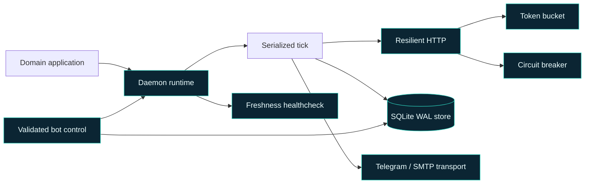

# radar-core

[](https://github.com/Arreketefo/radar-core/actions/workflows/ci.yml)
[](https://www.python.org/)
[](LICENSE)

**A small, reusable runtime for resilient async polling services.**

`radar-core` contains the infrastructure shared by a family of always-on data
radars. It handles rate limits, transient failures, scheduling, persistence,
health checks and operational control while keeping every product's domain
logic in the application that owns it.

The project was extracted only after the same patterns had survived three
independent implementations. That constraint is still its main design rule:
if a component needs to know what a flight, listing, property or audience metric
is, it does not belong in the core.

## What it provides

| Capability | What it protects against |
| --- | --- |
| Async token bucket | Provider quota overruns and accidental request bursts |
| Retry with exponential backoff and jitter | Transient transport, `429` and `5xx` failures |
| Per-provider circuit breaker | Repeatedly hammering a failing dependency |
| SQLite base store with WAL | Inconsistent connection and persistence behavior |
| Graceful daemon runtime | Losing in-flight writes or creating duplicate alerts on shutdown |
| Freshness health checks | A process that is alive but no longer doing useful work |
| Validated runtime overrides | Unsafe or unbounded configuration changes |
| Telegram and SMTP transports | Reimplementing delivery mechanics in every application |
| Median + MAD helpers | Fragile baselines in noisy price and metric streams |

## Architecture



Applications provide the source adapters, schemas, matching rules, schedulers
and message rendering. The core provides the failure-handling and lifecycle
discipline around them.

The detailed design and admission rules live in
[`radar-core-arquitectura.md`](radar-core-arquitectura.md).

## Quick start

Requirements: Python 3.12+ and [`uv`](https://docs.astral.sh/uv/).

```bash
git clone https://github.com/Arreketefo/radar-core.git
cd radar-core
uv sync --locked --dev

uv run pytest -q
uv run ruff check .
uv run mypy radar_core
```

Build the wheel and source distribution locally:

```bash
uv build
```

Applications can consume a tagged Git release directly once the repository is
public, or use a local path while developing the core and a consumer together:

```toml
[project]
dependencies = ["radar-core"]

[tool.uv.sources]
radar-core = { path = "../radar-core" }
```

Production consumers may vendor a reviewed, tagged snapshot when deployment
environments deliberately have no Git credentials.

## Example: resilient provider call

```python
import httpx

from radar_core.http import CircuitBreaker, get_json
from radar_core.ratelimit import TokenBucket


async def fetch_items(client: httpx.AsyncClient) -> object:
    quota = TokenBucket(rate=2.0, capacity=5.0)
    breaker = CircuitBreaker(threshold=3, cooldown_s=300)
    return await get_json(
        client,
        "https://api.example.com/items",
        {"limit": 20},
        quota,
        breaker,
        headers={"Authorization": "Bearer <token>"},
    )
```

Secrets belong in headers or request bodies, never in URLs that can be exposed
by access logs, exception traces or monitoring tools.

## Engineering guarantees

- Ticks never overlap inside one daemon.
- Shutdown waits for an in-flight tick before closing resources.
- Retryable failures use bounded exponential backoff with jitter.
- Circuit breakers fail fast during a provider cooldown.
- Configuration overrides are allowlisted and validated.
- Bot commands never execute a shell or mutate arbitrary files.
- SQLite connections enable WAL, foreign keys and an explicit durability mode.
- The package is fully typed and checked with strict mypy settings.

These guarantees are executable: the current suite contains 29 focused tests
covering rate limiting, retries, circuit breaking, persistence, health state,
statistics, notifications and bot control.

## Scope

`radar-core` intentionally does **not** include:

- provider-specific API clients;
- product contracts or matching engines;
- application database schemas;
- domain schedulers;
- alert wording or presentation;
- deployment credentials or infrastructure configuration.

Keeping that boundary narrow is more important than reducing a few lines of
duplication.

## Security

See [`SECURITY.md`](SECURITY.md) for responsible reporting. Never include real
credentials, account identifiers or production data in an issue or test fixture.

## Contributing

Small, domain-free improvements are welcome. Read
[`CONTRIBUTING.md`](CONTRIBUTING.md) before proposing a change.

## License

Licensed under the [Apache License 2.0](LICENSE).
